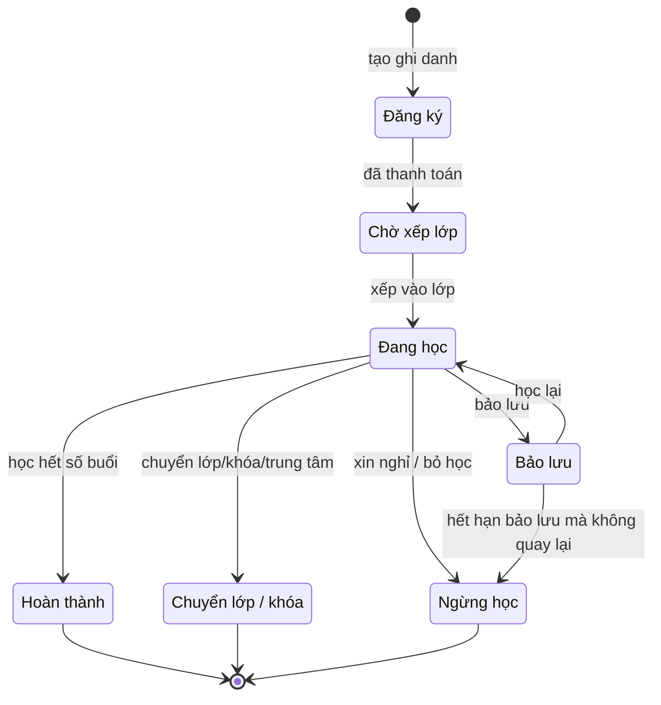

# 4. Ghi danh & quỹ buổi học

Ghi danh là trung tâm của hệ thống. Số buổi còn lại và số tiền còn lại của học viên đều được tính từ các phát sinh trên ghi danh, không nhập tay.

## Ghi danh là gì

Một ghi danh = 1 học viên × 1 khóa (hoặc gói buổi) × 1 trung tâm × mức giá và chính sách tại thời điểm ký. Ghi danh được gắn vào một lớp, và có thể đổi lớp mà vẫn giữ nguyên ghi danh.

## Vòng đời ghi danh

Bảo lưu là trạng thái tạm dừng có thể quay lại. Chuyển, Hoàn thành và Ngừng học đều kết thúc ghi danh. Chuyển = đóng ghi danh cũ, mở ghi danh mới mang theo số dư buổi và tiền. Mọi chuyển trạng thái đều để lại phát sinh buổi/tiền.

## Quỹ buổi học: các loại phát sinh

**Đề xuất mặc định (QĐ-02):** mỗi buổi lớp diễn ra đều trừ 1 buổi của học viên, dù có mặt hay vắng. Vắng có phép được cấp 1 quyền học bù có thời hạn. Số buổi còn lại hiển thị cho phụ huynh = buổi chưa diễn ra + quyền học bù còn hiệu lực.

| Phát sinh | Tác động | Ai tạo | Cần duyệt |
| --- | --- | --- | --- |
| Mua khóa / gói | + N buổi | Tư vấn, lễ tân | Không |
| Tặng buổi (khuyến mãi, đền bù) | + k buổi | Quản lý trung tâm | Có |
| Có mặt | − 1 buổi | Điểm danh | Không |
| Vắng không phép | − 1 buổi | Điểm danh | Không |
| Vắng có phép | − 1 buổi, + 1 quyền học bù | Điểm danh | Không |
| Học bù | − 1 quyền học bù | Điểm danh lớp nhận bù | Không |
| Quyền học bù hết hạn | − 1 quyền học bù | Hệ thống | Không |
| Buổi do trung tâm hủy | Không trừ, buổi được dời | Hệ thống | Không |
| Chuyển ra / chuyển vào | − / + số dư quy đổi | Quản lý trung tâm | Có |
| Hoàn phí | − số buổi được hoàn | Kế toán | Có |
| Điều chỉnh sai sót | ±, bắt buộc ghi lý do | Quản lý trung tâm | Có |

## Các nghiệp vụ trên ghi danh

1. **Ghi danh mới**: chọn khóa, chọn lớp (hoặc chờ xếp lớp), áp ưu đãi, xác nhận chính sách, tạo khoản phải thu.
2. **Vào lớp muộn**: số buổi = số buổi còn lại của lớp; học phí tính theo tỉ lệ, hoặc thu đủ và cho học bù phần đã qua.
3. **Đổi lớp trong cùng khóa**: số dư giữ nguyên.
4. **Chuyển khóa hoặc cấp độ**: đóng ghi danh cũ (quy đổi số buổi còn lại ra tiền theo đơn giá thực trả), mở ghi danh mới, thu thêm hoặc giữ phần chênh lệch.
5. **Chuyển trung tâm**: xử lý như chuyển khóa; doanh thu ghi nhận tại nơi học thực tế (QĐ-05).
6. **Bảo lưu**: dừng trừ buổi, giữ số dư theo đơn giá thực trả, có thời hạn. Khi quay lại, xếp vào lớp phù hợp trình độ hiện tại (QĐ-03).
7. **Gia hạn**: kéo dài thời hạn gói buổi hoặc quyền học bù, có thể tính phí.
8. **Chuyển nhượng** cho người khác (QĐ-16).
9. **Ngừng học**: có hoặc không hoàn phí theo chính sách (QĐ-04).
10. **Hoàn thành**: gợi ý khóa tiếp theo và đưa vào danh sách tái ghi danh.

## Quy tắc toàn vẹn dữ liệu

1. Không sửa trực tiếp số buổi còn lại. Mọi thay đổi là một phát sinh có lý do, người tạo và thời điểm.
2. Phát sinh đã tạo không được xóa. Nếu sai thì tạo phát sinh đảo.
3. Nghiệp vụ làm thay đổi cả buổi và tiền (chuyển, hoàn, bảo lưu) phải hoàn tất trong một thao tác duy nhất.
4. **Đơn giá thực trả mỗi buổi** = học phí sau ưu đãi ÷ số buổi mua. Dùng thống nhất cho chuyển, bảo lưu, hoàn phí và ghi nhận doanh thu.
5. Ghi danh lưu phiên bản chính sách tại thời điểm ký.
6. Cảnh báo tự động khi còn ≤ 3 buổi (nhắc tái ghi danh) và khi quyền học bù sắp hết hạn (nhắc phụ huynh).

## Tình huống ngoại lệ

- Học thử rồi ghi danh: mặc định buổi học thử không tính vào khóa và không thu phí (QĐ-15).
- Đã đóng tiền nhưng chưa có lớp quá 30 ngày: cảnh báo "tiền treo".
- Lớp đã kết thúc mà học viên còn quyền học bù: cho bù ở lớp khác trong thời hạn.
- Hai ghi danh cùng một khóa cho cùng học viên: cảnh báo trùng.
- Gói buổi bị dùng quá số đã mua: mặc định cho học nợ tối đa 2 buổi và cảnh báo thu tiền.

## Giai đoạn

Giai đoạn 1: toàn bộ, trừ chuyển nhượng (giai đoạn 2).
