# Phân tích UI/UX & Design — Video demo "EMS · Tổ chức thi"

> Nguồn: `Screen_Recording_2026-10-09_at_15_03_33.mp4` (73 giây, 3244×2136, 60 fps).
> Ứng dụng web chạy trên `localhost:5173` (dev server Vite), xem trong Safari macOS.
> Ảnh minh họa nằm ở thư mục `img/` cạnh file này.

---

## 0. Tóm tắt nhanh

**EMS · Tổ chức thi** là phần mềm quản lý khảo thí: ngân hàng câu hỏi → đề thi → kỳ thi → chấm thi → báo cáo. Video tập trung vào module **Ngân hàng câu hỏi**, xem dưới 2 vai trò (Cán bộ khảo thí và Giáo viên / Người ra đề), ở cả giao diện Sáng và Tối.

| Hạng mục | Đánh giá | Ghi chú ngắn |
| --- | --- | --- |
| Bố cục tổng thể | Rất tốt | Layout admin chuẩn: top bar + sidebar nhóm chức năng + vùng nội dung có breadcrumb |
| Hệ thống màu | Tốt | Một màu nhấn đỏ-cam duy nhất; trạng thái và độ khó dùng màu ngữ nghĩa nhất quán |
| Typography | Tốt | Sans-serif hệ thống, hiển thị tiếng Việt tốt, công thức toán render bằng KaTeX |
| Dark mode | Rất tốt | Có đủ Sáng / Tối / Theo hệ thống; các token màu được map lại đầy đủ |
| Luồng nghiệp vụ | Rất tốt | Soạn → Gửi duyệt → Duyệt/Trả lại có góp ý → Lịch sử phiên bản |
| Bảng & bộ lọc | Rất tốt | Lọc phụ thuộc (Chương cần chọn Môn trước), đếm số lọc, Xóa lọc, multi-select có tìm kiếm |
| Trình soạn câu hỏi | Khá | Hỗ trợ 9 loại câu và chèn công thức LaTeX, nhưng soạn bằng textarea thô, không WYSIWYG |
| Nhất quán | Khá | Còn lẫn tiếng Anh (phân trang, file picker), lẫn select gốc của trình duyệt với dropdown tự dựng |
| Accessibility | Trung bình | Chữ phụ trong dark mode tương phản thấp, một số nút chỉ có icon |
| Sẵn sàng production | Chưa | Còn dấu vết demo: tài khoản demo trên màn hình đăng nhập, công tắc vai trò, chip "Mã 1.1 · Đợt 1" |

---

## 1. Diễn biến video (timeline)

| Thời điểm | Vai trò | Màn hình / thao tác |
| --- | --- | --- |
| 0:00 – 0:04 | Giáo viên (Lê Văn Giáo) | Danh sách câu hỏi (12 câu, giao diện Sáng) → mở menu tài khoản → **Đăng xuất** |
| 0:05 – 0:08 | — | Màn hình **Đăng nhập**, bấm chip tài khoản demo "Cán bộ khảo thí" |
| 0:08 – 0:10 | Cán bộ khảo thí (Trần Thị Khảo) | **Bảng điều khiển**: 5 thẻ KPI + danh sách "Ca thi sắp diễn ra" |
| 0:10 – 0:16 | Cán bộ khảo thí | Danh sách câu hỏi (29 câu, thêm cột "Người soạn") → mở **chi tiết** câu Sắp xếp và câu Chùm (đọc hiểu) |
| 0:16 – 0:18 | Cán bộ khảo thí | Menu **Giao diện** → chuyển sang **Tối** |
| 0:18 – 0:26 | Cán bộ khảo thí | Cuộn bảng, hover tiêu đề câu hỏi, **phân trang**, mở câu bị **Trả lại** (có hộp "Góp ý của người duyệt") |
| 0:26 – 0:36 | Cán bộ khảo thí | **Lọc nâng cao**: Độ khó (multi), Loại câu (multi), dropdown Môn học có ô tìm kiếm |
| 0:36 – 0:42 | Cán bộ khảo thí | **Danh mục và nhãn**: cây Môn → Chương, bảng Mức nhận thức / Chuẩn đầu ra |
| 0:42 – 0:48 | Cán bộ khảo thí | **Duyệt câu hỏi**: layout master–detail, tab Chờ duyệt / Trả lại / Đã duyệt |
| 0:48 – 0:52 | Cán bộ khảo thí | **Thống kê ngân hàng** → **Chuyển vai trò** sang Giáo viên |
| 0:52 – 1:09 | Giáo viên | **Soạn câu hỏi**: chọn loại câu, modal **Chèn công thức**, nút Hình ảnh (mở file picker), chuyển **Xem trước** |
| 1:10 – 1:13 | Giáo viên | Danh sách câu hỏi lọc "Ngữ văn 12" → **trạng thái rỗng** |

---

## 2. Kiến trúc thông tin & điều hướng

### 2.1 Khung ứng dụng (App shell)

```
┌───────────────────────────────────────────────────────────────────────────────┐
│ [E] EMS · Tổ chức thi          [◐] [🌐 VI ▾] [⇄ Vai trò ▾] [🔔 2] [👤 Tên ▾] │ ← Top bar ~56px
├──────────────┬────────────────────────────────────────────────────────────────┤
│ 🔍 Tìm chức  │  Breadcrumb: Nhóm (link đỏ) / Trang hiện tại                    │
│    năng      │  Tiêu đề trang (H1)                 [Tìm] [Môn ▾] [Lọc] [CTA]   │
│              │  Phụ đề (đếm số bản ghi)                                        │
│ Tổng quan  ˅ │  ┌──────────────────────────────────────────────────────────┐  │
│  ▸ mục       │  │ Bảng / card nội dung                                      │  │
│ Ngân hàng  ˅ │  │                                                          │  │
│  ▌mục active │  └──────────────────────────────────────────────────────────┘  │
│ Đề thi     ˅ │  Phân trang                                                     │
│ …            │                                                                │
└──────────────┴────────────────────────────────────────────────────────────────┘
   Sidebar ~260px            Vùng nội dung (fluid, padding ~32px)
```

### 2.2 Top bar (từ trái sang phải)

| Thành phần | Mô tả | Nhận xét |
| --- | --- | --- |
| Logo + tên | Ô vuông đỏ bo góc chứa chữ "E" + "EMS · Tổ chức thi" | Đơn giản, dễ nhận diện; dấu "·" phân tách tên sản phẩm và mô tả |
| Nút giao diện | Icon màn hình (Theo hệ thống) / mặt trăng (Tối) | Icon đổi theo trạng thái, giúp người dùng biết chế độ hiện tại. **Thiếu tooltip/nhãn** |
| Ngôn ngữ | 🌐 VI ▾ | Có sẵn đa ngôn ngữ (i18n) |
| Chuyển vai trò | ⇄ + tên vai trò ▾ | Menu ghi "Xem với vai trò (demo)", mỗi vai trò có 1 dòng mô tả quyền. Chỉ dùng cho demo, nhưng mẫu thiết kế này hay cho người **thực sự giữ nhiều vai trò** |
| Thông báo | 🔔 + badge số "2" | Badge bo tròn, nền xám nhạt (không đỏ), không gây hoảng |
| Tài khoản | 👤 Họ tên ▾ | Dropdown: tên, `username · Tổ bộ môn`, nút **Đăng xuất** màu đỏ có icon |

### 2.3 Sidebar

- Ô **"Tìm kiếm chức năng"** trên cùng (command search): hữu ích khi menu dài (>30 mục).
- Các nhóm có tiêu đề in đậm, **thu gọn/mở rộng** bằng chevron: Tổng quan, Ngân hàng câu hỏi, Đề thi, Kỳ thi, Thí sinh, Chấm thi và phúc khảo, Báo cáo thống kê.
- Mỗi mục gồm icon line (stroke ~1.5px) + nhãn, cỡ ~14px.
- **Mục đang chọn**: nền hồng nhạt (`~#FADDD6` ở Sáng, `~#281515` ở Tối), chữ và icon đỏ, **thanh dọc đỏ 3px** ở mép trái nhóm.
- Hover: nền xám nhạt bo góc.
- **Menu thay đổi theo vai trò** (RBAC thể hiện ngay trên điều hướng):

| Nhóm | Cán bộ khảo thí thấy | Giáo viên / Người ra đề thấy |
| --- | --- | --- |
| Ngân hàng câu hỏi | Danh sách, Danh mục và nhãn, **Duyệt câu hỏi**, Thống kê | Danh sách, **Soạn câu hỏi**, **Import câu hỏi**, Danh mục và nhãn, Thống kê |
| Đề thi | Ma trận, Danh sách, Sinh mã đề, **Duyệt và khóa đề**, Xem trước và in | Ma trận, Danh sách, **Tạo đề**, Sinh mã đề, Xem trước và in |
| Khác | **Kỳ thi** (Danh sách, Thiết lập, Ca thi, Phòng thi, Xếp thí sinh, Phân công cán bộ, Cấu hình làm bài, Cấu hình chống gian lận) | **Thí sinh** (Lớp/Nhóm), **Chấm thi và phúc khảo** (Chấm tự luận, Chấm phiếu giấy), Báo cáo thống kê |

- URL (thấy ở thanh trạng thái): `/question-bank/questions`, `/question-bank/categories`, `/question-bank/compose`, tức route đặt theo module, bằng tiếng Anh, dạng kebab-case.

### 2.4 Breadcrumb & tiêu đề trang

- Breadcrumb: cấp cha là **link màu đỏ**, cấp hiện tại màu chữ thường, phân tách bằng "/".
- Tiêu đề trang ~18px semibold. Ngay dưới là **phụ đề đếm số lượng** ("12 câu hỏi", "29 câu hỏi", "0 câu hỏi"), số này cập nhật theo bộ lọc.
- Hàng công cụ nằm cùng hàng tiêu đề, căn phải: Tìm kiếm → Lọc môn → Lọc nâng cao → Import (outline) → **CTA chính** (nền đỏ, icon "+").

---

## 3. Visual design system

### 3.1 Màu sắc (ước lượng bằng cách lấy mẫu pixel từ video, có sai số do nén)

| Token | Sáng | Tối | Dùng cho |
| --- | --- | --- | --- |
| `primary` | `~#DA350E` (đỏ-cam) | giữ nguyên, hơi trầm hơn | CTA, logo, link breadcrumb, viền focus, tab/phân trang đang chọn |
| `primary-subtle` | `~#FADDD6` | `~#281515` | Nền mục nav đang chọn |
| `bg` | `#FFFFFF` | `~#0D1115` (đen pha xanh) | Nền trang |
| `surface-muted` | `~#F4F5F8` | `~#14181E` | Header bảng, dòng xen kẽ (zebra), nền login |
| `text` | `~#1C1D20` | `~#E6E8EB` | Chữ chính |
| `text-muted` | xám ~`#6B7280` | xám ~`#8B9199` | Phụ đề, meta, placeholder |
| `border` | xám rất nhạt | xám đậm ~`#2A2F36` | Card, ô nhập, bảng |
| `success` | xanh lá `~#177131` (chấm) | xanh lá sáng | Độ khó **Dễ**, chip **Đã duyệt**, "✓ Đáp án" |
| `warning` | vàng-nâu `~#8C5B00` | vàng hổ phách | Độ khó **Trung bình**, chip **Chờ duyệt** |
| `danger` | đỏ `~#CA1E28` | đỏ | Độ khó **Khó**, chip **Trả lại**, nút Xóa, hộp góp ý trả lại |

**Nhận xét:**
- Màu nhấn duy nhất là đỏ-cam, dùng tiết chế: chỉ 1 nút đỏ đặc trên mỗi màn hình. Thiết kế giữ được vẻ "nghiêm túc, hành chính".
- **Điểm cần cân nhắc:** đỏ vừa là màu thương hiệu vừa là màu nguy hiểm (Khó, Trả lại, Xóa). Người dùng có thể đọc nhầm nút "Soạn câu hỏi" màu đỏ thành hành động nguy hiểm. Hướng khắc phục: tách đỏ thương hiệu sang tông cam hơn, hoặc đổi danger sang đỏ hồng.
- Dark mode không đảo màu máy móc: nền đen pha xanh, mục active dùng nền đỏ rất trầm, chip giữ viền màu. Đây là cách làm đúng.

### 3.2 Typography

- Font sans-serif hệ thống (trên macOS có vẻ là SF Pro/Inter), dấu tiếng Việt hiển thị chuẩn, không lỗi xếp dấu.
- Thang chữ ước lượng: H1 trang ~18–20px/600 · tiêu đề card ~16px/600 · chữ thường 14px · meta 12px · chip 11–12px · số KPI ~28px/700.
- **Công thức toán render bằng KaTeX** (font Computer Modern nghiêng) ngay trong bảng, modal, khung duyệt. Đây là điểm cộng lớn cho môn Toán và Lý.
- Nội dung dài trong bảng được **cắt ở 2 dòng kèm "…"**, dòng phụ bên dưới hiển thị đường dẫn phân loại "Toán 12 › Ứng dụng đạo hàm" (12px, màu muted).
- Mã câu hỏi `Q00012` dùng chữ thường (không monospace). Nên dùng chữ số tabular để các mã thẳng cột.

### 3.3 Khoảng cách, bo góc, đổ bóng

- Lưới 4/8px. Padding vùng nội dung ~32px. Khoảng cách giữa các thẻ KPI ~16px.
- Bo góc: nút và ô nhập ~6–8px, card ~10–12px, chip dạng pill (bo tròn hoàn toàn).
- Hầu như **không có đổ bóng**: phân lớp bằng viền 1px và nền xám nhạt. Chỉ modal và dropdown có bóng mờ cùng lớp phủ tối.
- Dòng bảng cao ~64–76px (2 dòng chữ + dòng meta), khá thoáng nhưng mỗi màn hình chỉ chứa khoảng 9–10 dòng.

### 3.4 Iconography

- Bộ icon line đồng nhất (giống Lucide/Tabler), stroke mảnh.
- **Mỗi loại câu hỏi có 1 icon riêng** và được dùng lại ở bảng, bộ lọc, thống kê, danh sách duyệt:

| Loại câu | Icon |
| --- | --- |
| 1 đáp án | ⊙ hình tròn có chấm |
| Nhiều đáp án | ☰ danh sách có dấu tick |
| Đúng/Sai | công tắc (toggle) |
| Điền khuyết | ô trống có con trỏ |
| Ghép cặp | ⇆ hai mũi tên ngược chiều |
| Sắp xếp | danh sách đánh số 1-2-3 |
| Trả lời ngắn | chữ T |
| Tự luận | tờ giấy có dòng kẻ |
| Câu chùm | các lớp chồng nhau (layers) |

→ Đây là **ngôn ngữ hình ảnh nhất quán**. Sau vài phút sử dụng, người dùng nhận ra loại câu chỉ cần nhìn icon.

### 3.5 Bộ component quan sát được

| Component | Biến thể / trạng thái quan sát |
| --- | --- |
| Button | Primary (đỏ đặc), Secondary (outline xám), Ghost (chỉ chữ), Danger-outline ("Xóa", "Trả lại"), Disabled (đỏ mờ "Chèn") |
| Chip / Tag | Chip trạng thái có viền màu (Chờ duyệt, Đã duyệt, Trả lại), "Nháp" xám không viền; chip thuộc tính (loại, môn › chương, độ khó, mức nhận thức, mã chuẩn) dạng pill viền xám |
| Dot indicator | Chấm tròn 6px + chữ cho độ khó (Dễ / Trung bình / Khó) |
| Segmented control | Soạn thảo / Xem trước; Độ khó Dễ / Trung bình / Khó (kèm chấm màu); Mức nhận thức / Chuẩn đầu ra (kèm số đếm) |
| Tabs có đếm | "● Chờ duyệt 6 · ● Trả lại 2 · ● Đã duyệt 17" (chấm màu trạng thái + badge số) |
| Dropdown multi-select | Tiêu đề, ô tìm kiếm có viền focus đỏ, checkbox đỏ, icon/chấm màu đầu mỗi dòng, vạch đỏ đánh dấu dòng đang hover |
| Dropdown đơn | "Tất cả môn" → danh sách môn có ô tìm |
| Select gốc của trình duyệt | Môn học, Chương, Mức nhận thức ở form soạn (mũi tên ⇕ của macOS) — **không đồng bộ** với dropdown tự dựng |
| Table | Header nền xám, zebra, cột sắp xếp (↓), cột có icon filter (Người soạn ≡), checkbox chọn dòng, menu "⋯" cuối dòng |
| Pagination | Page size 10/20/50 (chọn = ô đỏ), "1 - 10 of 29", Previous · 1 2 3 · Next |
| Modal | Header (tiêu đề + meta + ✕), body cuộn, footer căn phải |
| Alert | Hộp đỏ nhạt có icon ⓘ: "Góp ý của người duyệt" |
| Timeline | Lịch sử phiên bản: chấm + đường dọc, sự kiện in đậm + "v1 · người · giờ ngày" + link "Xem nội dung" + trích dẫn góp ý (viền trái) |
| KPI card | Nhãn nhỏ → số lớn → chú thích ("+1 so với tuần trước", "Trong 30 ngày tới") |
| Tree view | Môn (icon sách) → Chương (icon thư mục), số câu căn phải, chevron mở rộng |
| Bar list | Thanh ngang xám + nhãn "n câu" căn phải |
| Empty state | Icon kính lúp, tiêu đề đậm "Không có câu hỏi phù hợp", gợi ý "Thử bỏ bớt điều kiện lọc." |

---

## 4. Phân tích chi tiết từng màn hình

### 4.1 Đăng nhập — `img/01-dang-nhap.jpg`

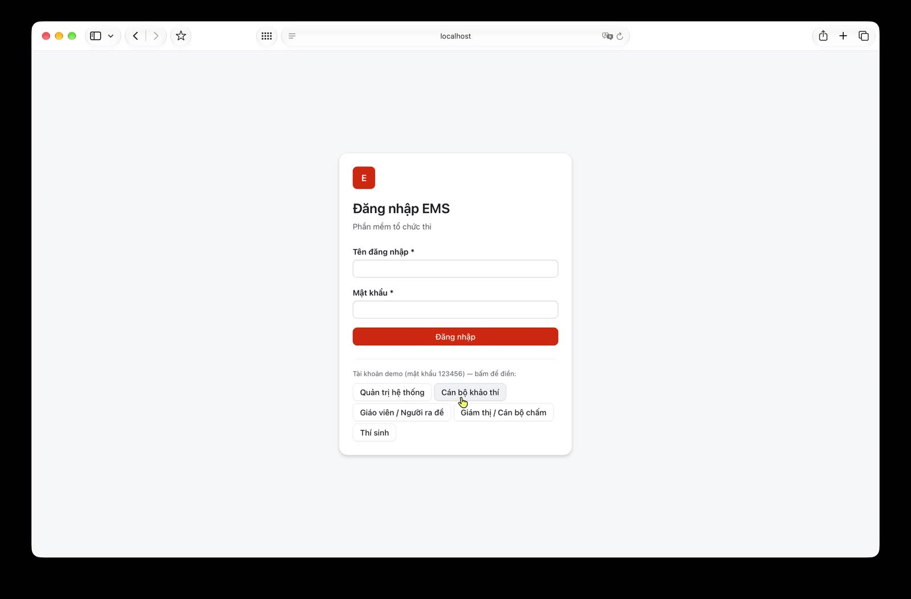

- Card trắng ~400px ở giữa, nền xám nhạt. Logo "E" → "Đăng nhập EMS" → phụ đề "Phần mềm tổ chức thi".
- 2 trường bắt buộc (dấu * đỏ): Tên đăng nhập, Mật khẩu. Nút "Đăng nhập" đỏ, rộng full.
- **Tài khoản demo**: "(mật khẩu 123456) — bấm để điền", kèm 5 chip vai trò. Rất tiện khi demo cho khách hàng.

**Cần cải thiện:**
- Thiếu "Quên mật khẩu", "Hiện/ẩn mật khẩu", "Ghi nhớ đăng nhập", chọn ngôn ngữ và chọn giao diện ngay trên trang đăng nhập.
- Không có vùng nhận diện thương hiệu (ảnh, tên trường hoặc đơn vị).
- **Phải gỡ khối tài khoản demo khi lên production**, hoặc ẩn bằng feature flag.

### 4.2 Bảng điều khiển — `img/02-bang-dieu-khien.jpg`

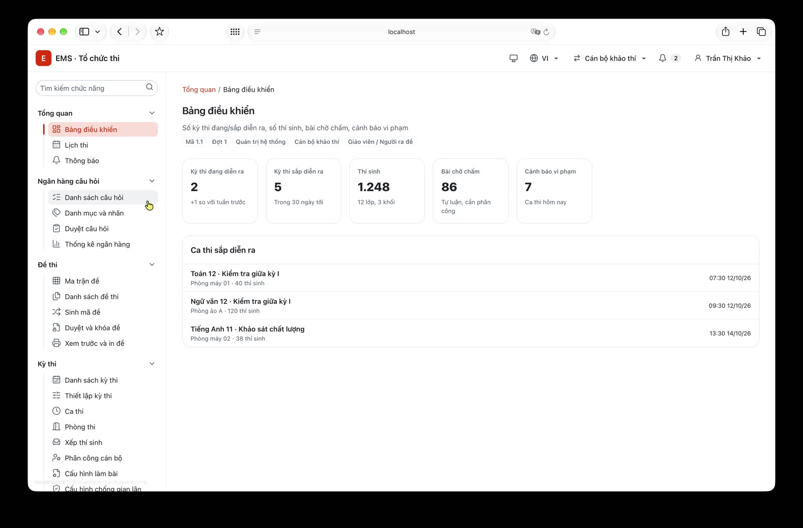

- Mô tả trang: "Số kỳ thi đang/sắp diễn ra, số thí sinh, bài chờ chấm, cảnh báo vi phạm".
- **5 thẻ KPI**: Kỳ thi đang diễn ra **2** (+1 so với tuần trước) · Kỳ thi sắp diễn ra **5** (trong 30 ngày tới) · Thí sinh **1.248** (12 lớp, 3 khối) · Bài chờ chấm **86** (tự luận, cần phân công) · Cảnh báo vi phạm **7** (ca thi hôm nay).
- Card "Ca thi sắp diễn ra": mỗi dòng có tên đậm "Toán 12 · Kiểm tra giữa kỳ I", dòng phụ "Phòng máy 01 · 40 thí sinh", thời gian căn phải "07:30 12/10/26".

**Điểm tốt:** mỗi KPI có ngữ cảnh (so sánh hoặc giải thích). Số dùng dấu chấm phân cách hàng nghìn kiểu Việt Nam (1.248).

**Cần cải thiện:**
- Thẻ KPI **không bấm được**. Lẽ ra "Bài chờ chấm 86" phải dẫn thẳng tới danh sách chờ chấm.
- "Cảnh báo vi phạm 7" là việc khẩn nhưng không được làm nổi bật bằng màu.
- Hàng chip "Mã 1.1 · Đợt 1 · Quản trị hệ thống · …" là **dấu vết của tài liệu đặc tả** lọt lên giao diện.
- Ô KPI chỉ chiếm ~2/3 chiều rộng, bên phải trống.
- Dashboard gần như không có nội dung bên dưới, chưa tận dụng cho việc cần làm, hoạt động gần đây hay biểu đồ.

### 4.3 Danh sách câu hỏi — `img/03`, `img/07`

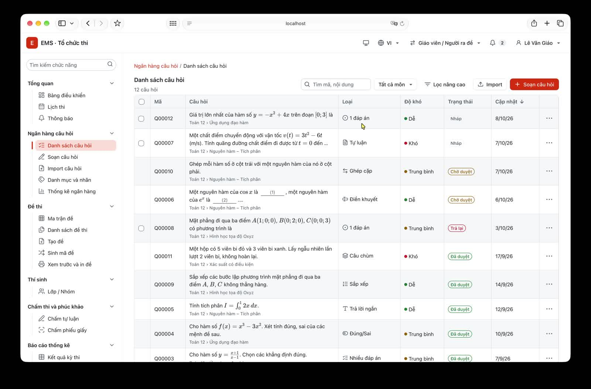

**Cấu trúc cột:** ☐ · Mã · Câu hỏi (nội dung 2 dòng + đường dẫn môn › chương) · Loại (icon + tên) · Độ khó (chấm + chữ) · Trạng thái (chip) · [Người soạn ≡ — chỉ hiện với Cán bộ khảo thí] · Cập nhật ↓ · ⋯

**Những điểm thiết kế hay:**
- **Render công thức ngay trong bảng** (KaTeX), điền khuyết hiển thị thành ô gạch chân có số `(1)`, `(2)`. Người dùng thấy đúng câu hỏi trông ra sao mà không cần mở chi tiết.
- **Checkbox chỉ xuất hiện ở các câu còn sửa được** (Nháp, Trả lại). Câu Chờ duyệt / Đã duyệt không có checkbox. Đây là cách nói ngầm "chỉ thao tác hàng loạt được với câu của bạn đang soạn".
- **Hiển thị khác nhau theo vai trò**: Giáo viên chỉ thấy câu của mình (12 câu) và có nút Import + Soạn câu hỏi. Cán bộ khảo thí thấy toàn bộ (29 câu), có thêm cột Người soạn và không có nút soạn.
- Hover tiêu đề câu hỏi → **chữ chuyển đỏ và gạch chân** (đây là link mở chi tiết).
- Zebra nhẹ giúp mắt bám dòng khi bảng có nhiều cột.

**Cần cải thiện:**
- **Bảng bị tràn ngang khi có thêm cột "Người soạn"**: cột "Cập nhật" bị cắt (chỉ thấy "8", "7") ở độ rộng ~1500px. Cần cột ẩn/hiện, cố định cột ⋯, hoặc thu hẹp cột Câu hỏi.
- **Phân trang còn tiếng Anh**: "Page size", "1 - 10 of 29", "Previous", "Next" (đặt cạnh giao diện tiếng Việt).
- Không thấy **thanh hành động hàng loạt** khi chọn checkbox (Gửi duyệt, Xóa, Gán chương…).
- Ngày dạng `8/10/26` dễ nhầm giữa ngày/tháng và tháng/ngày. Nên dùng `08/10/2026`, hoặc "2 ngày trước" kèm tooltip ngày đầy đủ.
- Menu "⋯" không được mở trong video, nên chưa rõ có những hành động gì.
- Chip "Nháp" không có viền, khác với các chip trạng thái còn lại (có thể cố ý để "Nháp" trông nhẹ hơn, nhưng làm hệ chip mất đồng bộ).

### 4.4 Giao diện Sáng / Tối — `img/04`, `img/07`

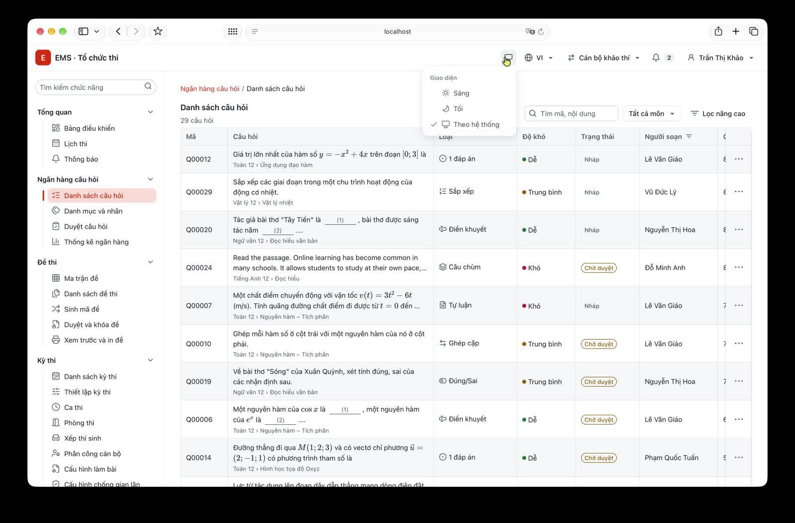

- Menu "Giao diện": ☀ Sáng · ☾ Tối · 🖥 Theo hệ thống (✓). Mặc định theo hệ điều hành, đây là lựa chọn đúng.
- Chuyển chế độ ngay lập tức, không reload. Mọi thành phần (KaTeX, chip, modal, dropdown, bảng) đều có màu tối tương ứng.

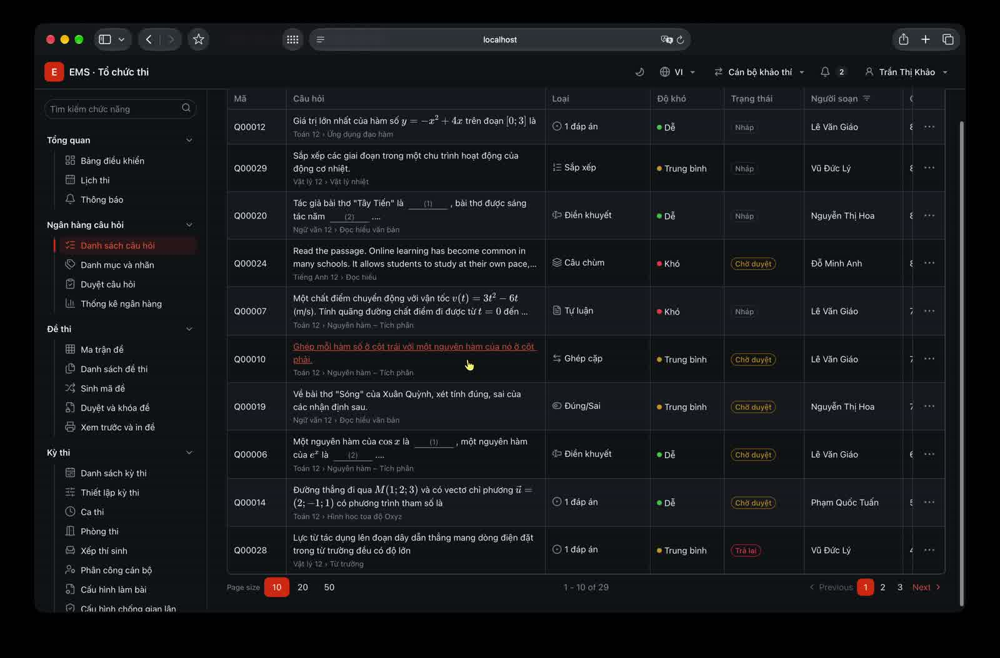

**Nhận xét dark mode:**
- Nền gần đen (`#0D1115`) chứ không đen tuyệt đối, đỡ mỏi mắt.
- Chip trạng thái chuyển sang viền màu + chữ màu trên nền tối, vẫn đọc rõ.
- **Chữ meta 11–12px màu xám** (đường dẫn môn › chương, thời gian) có **tương phản thấp**, nhiều khả năng dưới 4.5:1.
- Dòng zebra ở chế độ tối gần như không phân biệt được với dòng thường.

### 4.5 Modal chi tiết câu hỏi — `img/05`, `img/06`

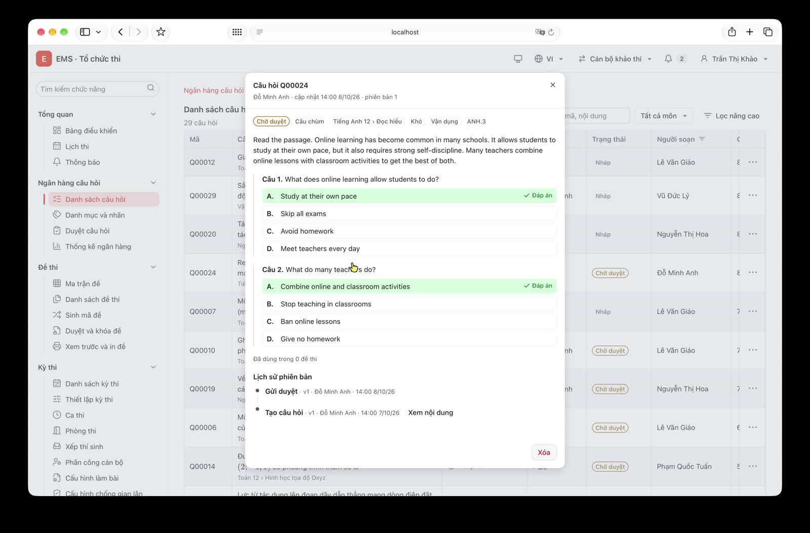

**Cấu trúc:**
1. Header: "Câu hỏi Q00024" + meta "Đỗ Minh Anh · cập nhật 14:00 8/10/26 · phiên bản 1" + ✕.
2. **Hàng chip thuộc tính**: [Trạng thái có màu] · Loại · Môn › Chương · Độ khó · Mức nhận thức · Mã chuẩn đầu ra (ANH.3).
3. **Nội dung hiển thị theo loại câu**:
   - *Sắp xếp*: "Thứ tự đúng" + danh sách đánh số trong các ô.
   - *Câu chùm*: đoạn văn → "Câu 1.", "Câu 2." thụt lề, mỗi câu có phương án A–D.
   - *1 đáp án*: phương án có công thức. **Đáp án đúng có nền xanh nhạt + "✓ Đáp án" căn phải**.
4. "Đã dùng trong 0 đề thi" (thông tin quan trọng trước khi sửa hoặc xóa).
5. **Lịch sử phiên bản** dạng timeline: Tạo câu hỏi → Gửi duyệt → Trả lại (kèm trích góp ý), mỗi mốc có `v1 · người · thời gian`, link "Xem nội dung".
6. Footer: chỉ có nút **"Xóa"** (danger-outline).

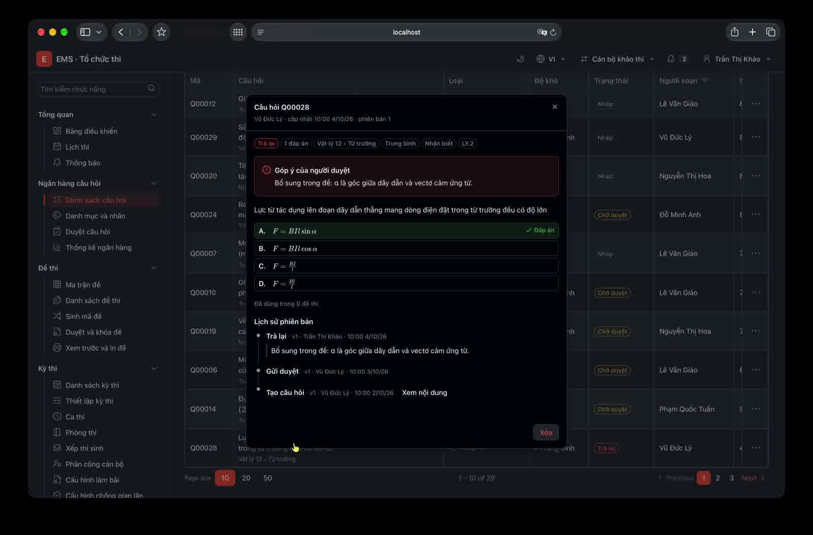

- Với câu bị Trả lại, **hộp "Góp ý của người duyệt"** (nền đỏ trầm, icon ⓘ) được đưa lên ngay dưới hàng chip, trước nội dung. Người soạn đọc lý do trước rồi mới xem câu hỏi. Đây là quyết định UX rất tốt.

**Cần cải thiện:**
- **Footer chỉ có "Xóa"**: hành động phá hủy là hành động duy nhất. Nên có "Sửa", "Nhân bản", "Duyệt/Trả lại" (theo quyền), và đẩy "Xóa" vào menu phụ.
- Cán bộ khảo thí xem câu của người khác mà vẫn có nút Xóa, cần kiểm tra lại quyền.
- Không có điều hướng "← câu trước / câu sau →" trong modal. Khi rà nhiều câu, người dùng phải đóng rồi mở lại.
- Modal câu chùm dài phải cuộn bên trong modal. Nên cân nhắc dùng drawer bên phải hoặc trang chi tiết riêng.

### 4.6 Bộ lọc nâng cao — `img/08`

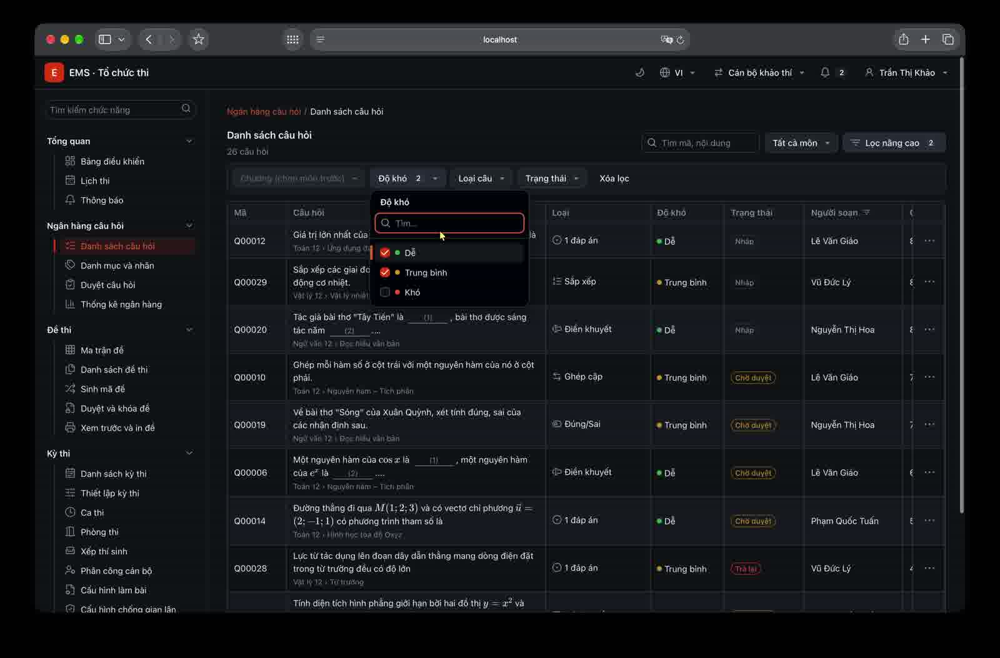

- Bấm "Lọc nâng cao" → mở **thanh lọc thứ 2** dạng hàng chip bên dưới tiêu đề (không mở modal, không chiếm cột bên).
- Các bộ lọc: **Chương (chọn môn trước)** ở trạng thái disabled, tự giải thích vì sao chưa dùng được · Độ khó · Loại câu · Trạng thái.
- Multi-select có ô **tìm kiếm** (viền đỏ khi focus), checkbox đỏ, mỗi lựa chọn kèm chấm màu hoặc icon loại câu.
- Khi đang lọc: nút hiển thị **số lượng giá trị đã chọn** ("Độ khó 2"), nút "Lọc nâng cao" có badge **2**, xuất hiện link **"Xóa lọc"**, và phụ đề cập nhật ngay "26 câu hỏi".

**Điểm tốt:** lọc tức thì không cần nút "Áp dụng". Bộ lọc phụ thuộc có giải thích. Luôn có cách thoát nhanh (Xóa lọc).

**Cần cải thiện:**
- Không thấy bộ lọc được **lưu vào URL** (để chia sẻ hoặc giữ khi quay lại) và chưa có "Lưu bộ lọc".
- Dropdown chỉ có 3 lựa chọn (Độ khó) không cần ô tìm kiếm.
- Khi thu gọn thanh lọc, không còn chỗ thấy đang lọc theo gì (chỉ còn badge số).

### 4.7 Danh mục và nhãn — `img/09`

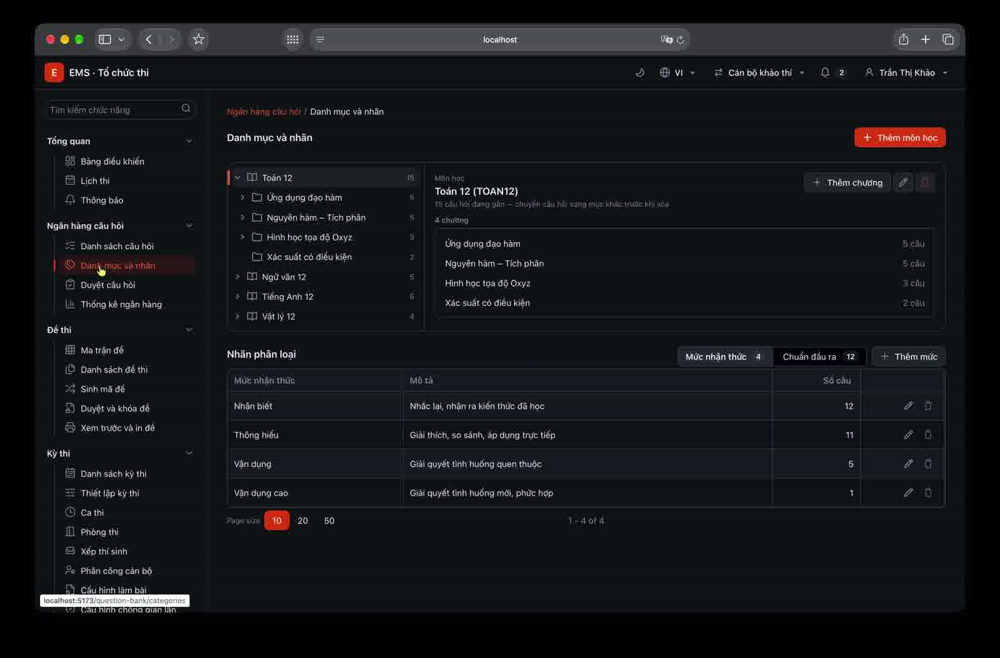

- **Layout 2 cột trong 1 card**: cây bên trái (Môn → Chương, số câu căn phải), bảng chi tiết bên phải (thông tin môn, mã "TOAN12", danh sách chương với số câu).
- **Bảo vệ toàn vẹn dữ liệu**: dòng "15 câu hỏi đang gắn — chuyển câu hỏi sang mục khác trước khi xóa", đồng thời **nút xóa bị vô hiệu**. Thay vì cho bấm rồi báo lỗi, giao diện giải thích trước vì sao không xóa được. Đây là pattern rất đáng học.
- Phần **"Nhãn phân loại"** có segmented control: Mức nhận thức (4) | Chuẩn đầu ra (12). Mỗi tab có bảng riêng (Mã, Mô tả, Môn, Số câu, ✎ 🗑) và nút "Thêm mức" hoặc "Thêm chuẩn" đổi theo tab. Tab Chuẩn đầu ra có thêm bộ lọc "Tất cả môn".

**Cần cải thiện:**
- Cây chỉ có 2 cấp, trong khi form soạn câu có cấp "Chủ đề". Cần thống nhất phân cấp Môn → Chương → Chủ đề.
- Không thấy kéo-thả để sắp xếp chương.
- Phân trang "1 - 4 of 4" vẫn hiện khi chỉ có 4 dòng (không cần thiết).

### 4.8 Duyệt câu hỏi — `img/10`

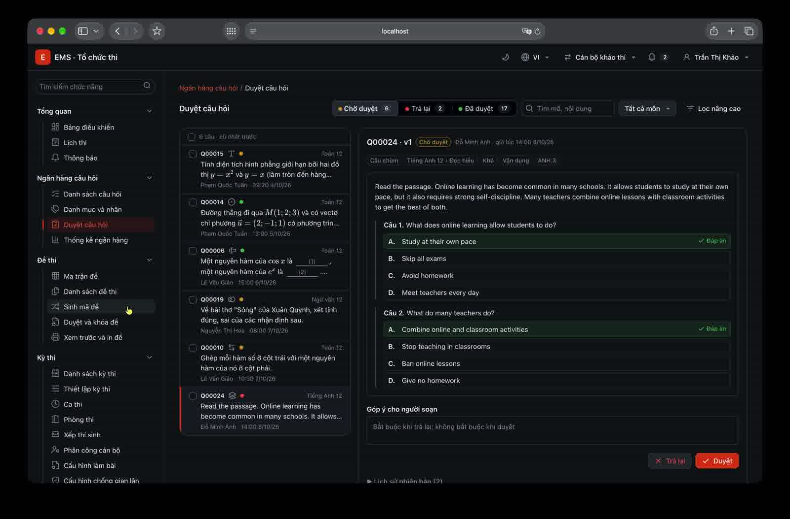

- **Layout master–detail** (giống hộp thư email): danh sách bên trái ~35%, chi tiết bên phải ~65%. Không cần mở modal, chọn câu là nội dung bên phải thay đổi theo.
- Header: **tab có chấm màu + số đếm** "Chờ duyệt 6 · Trả lại 2 · Đã duyệt 17", kèm tìm kiếm, lọc môn, lọc nâng cao.
- Danh sách ghi "6 câu · cũ nhất trước" (**sắp xếp FIFO**, công bằng với người gửi trước). Mỗi mục: checkbox · mã · icon loại · chấm độ khó · môn (căn phải) · 2 dòng nội dung · người gửi + thời gian. Mục đang xem có **viền đỏ bên trái**.
- Chi tiết: "Q00015 · v1" + chip Chờ duyệt + "Phạm Quốc Tuấn · gửi lúc 09:20 4/10/26", hàng chip thuộc tính, nội dung câu. Câu trả lời ngắn hiển thị **"Đáp án chấp nhận: 0,17 | 0.17 | 1/6"** (chấp nhận nhiều cách viết — rất thực tế).
- **"Góp ý cho người soạn"**: placeholder ghi rõ quy tắc "Bắt buộc khi trả lại; không bắt buộc khi duyệt".
- Hành động: **✕ Trả lại** (danger-ghost) và **✓ Duyệt** (primary). "▸ Lịch sử phiên bản (2)" thu gọn.

**Điểm tốt:** quy trình nhanh, giảm tối đa số click, quy tắc nghiệp vụ được viết thẳng vào placeholder.

**Cần cải thiện:**
- Không thấy **duyệt hàng loạt** (có checkbox nhưng không có thanh hành động).
- Không có phím tắt (J/K để chuyển câu, A để duyệt, R để trả lại). Người duyệt hàng trăm câu sẽ rất cần.
- Không thấy tự chuyển sang câu kế tiếp sau khi duyệt (cần kiểm chứng thêm).
- Không có **diff giữa các phiên bản** khi câu được gửi lại sau khi bị trả lại.

### 4.9 Thống kê ngân hàng — `img/11`

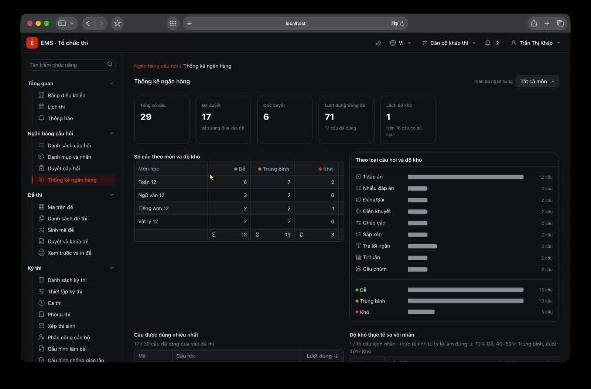

- **5 KPI**: Tổng số câu 29 · Đã duyệt 17 ("sẵn sàng đưa vào đề") · Chờ duyệt 6 · Lượt dùng trong đề 71 ("17 câu đã dùng") · **Lệch độ khó 1** ("trên 16 câu có số liệu").
- **Bảng chéo Môn × Độ khó** có hàng tổng Σ.
- **Bar list theo loại câu** (có icon) và theo độ khó (có chấm màu).
- "Câu được dùng nhiều nhất" (bảng sắp xếp theo lượt dùng).
- **"Độ khó thực tế so với nhãn"**: định nghĩa ngay trên UI "thực tế tính từ tỷ lệ làm đúng: ≥ 70% Dễ, 40–69% Trung bình, dưới 40% Khó". Đây là **insight chuyên môn khảo thí** rất giá trị, vì nó phát hiện câu bị gắn nhãn độ khó sai.

**Cần cải thiện:**
- Thanh bar **toàn màu xám**, kể cả nhóm độ khó vốn đã có chấm màu. Nên tô thanh theo màu độ khó.
- Bar list không có trục và không có %, khó so sánh tỉ lệ.
- Bảng chéo nên tô nền theo mật độ (heatmap) để thấy ngay chỗ thiếu câu Khó (ví dụ Ngữ văn 12 và Vật lý 12 có 0 câu Khó).
- KPI "Lệch độ khó" nên bấm được để lọc ra các câu bị lệch.

### 4.10 Chuyển vai trò (demo) — `img/12`

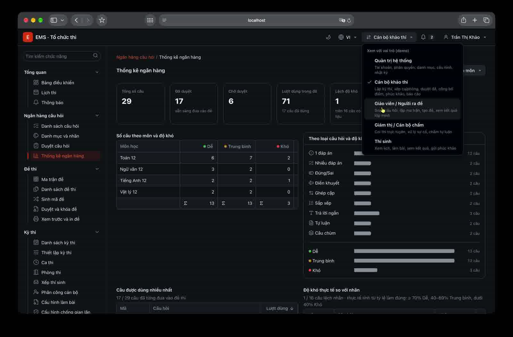

- Tiêu đề "Xem với vai trò (demo)". 5 vai trò, **mỗi vai trò có 1 dòng mô tả quyền**, ví dụ "Cán bộ khảo thí — Lập kỳ thi, xếp ca/phòng, duyệt đề, công bố điểm, phúc khảo, báo cáo". Vai trò đang dùng có dấu ✓.
- Khi đổi vai trò, sidebar, cột bảng và nút hành động thay đổi theo ngay, giúp kiểm tra phân quyền rất nhanh.

### 4.11 Soạn câu hỏi — `img/13`, `img/14`, `img/15`

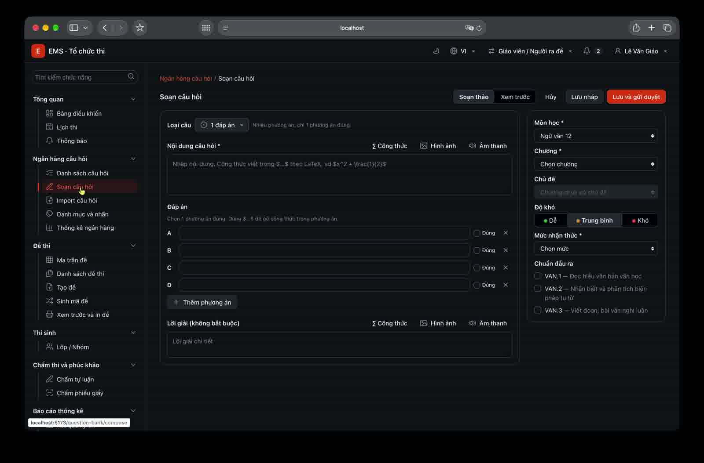

**Layout 2 cột**: trình soạn (~70%) + panel metadata (~30%).

**Thanh hành động trên cùng:** [Soạn thảo | Xem trước] (segmented) · Hủy (ghost) · Lưu nháp (secondary) · **Lưu và gửi duyệt** (primary). Thứ tự từ yếu đến mạnh, nút mạnh nhất nằm ngoài cùng bên phải. Đúng chuẩn.

**Cột trình soạn:**
- **Loại câu**: dropdown có icon "⊙ 1 đáp án" + **mô tả ngay bên cạnh** "Nhiều phương án, chỉ 1 phương án đúng".
- **Nội dung câu hỏi \***: thanh công cụ nhỏ căn phải gồm **Σ Công thức · 🖼 Hình ảnh · 🔊 Âm thanh** (âm thanh dùng cho bài nghe tiếng Anh). Placeholder hướng dẫn cú pháp: "Công thức viết trong $...$ theo LaTeX, vd $x^2 + \frac{1}{2}$".
- **Đáp án**: hướng dẫn "Chọn 1 phương án đúng. Dùng $...$ để gõ công thức trong phương án." Các dòng A, B, C, D gồm nhãn, ô nhập, radio "Đúng" và nút ✕ xóa phương án. Nút "+ Thêm phương án".
- **Lời giải (không bắt buộc)**: có cùng thanh công cụ.

**Panel metadata (phải):**
- Môn học \* (select) → Chương \* (select) → **Chủ đề** (disabled, ghi "Chương chưa có chủ đề").
- **Độ khó**: segmented 3 nút có chấm màu, mặc định "Trung bình".
- Mức nhận thức \* (select "Chọn mức").
- **Chuẩn đầu ra**: danh sách checkbox **tự lọc theo môn** (Ngữ văn 12 → VAN.1, VAN.2, VAN.3 kèm mô tả).

**Modal "Chèn công thức"** — `img/14`

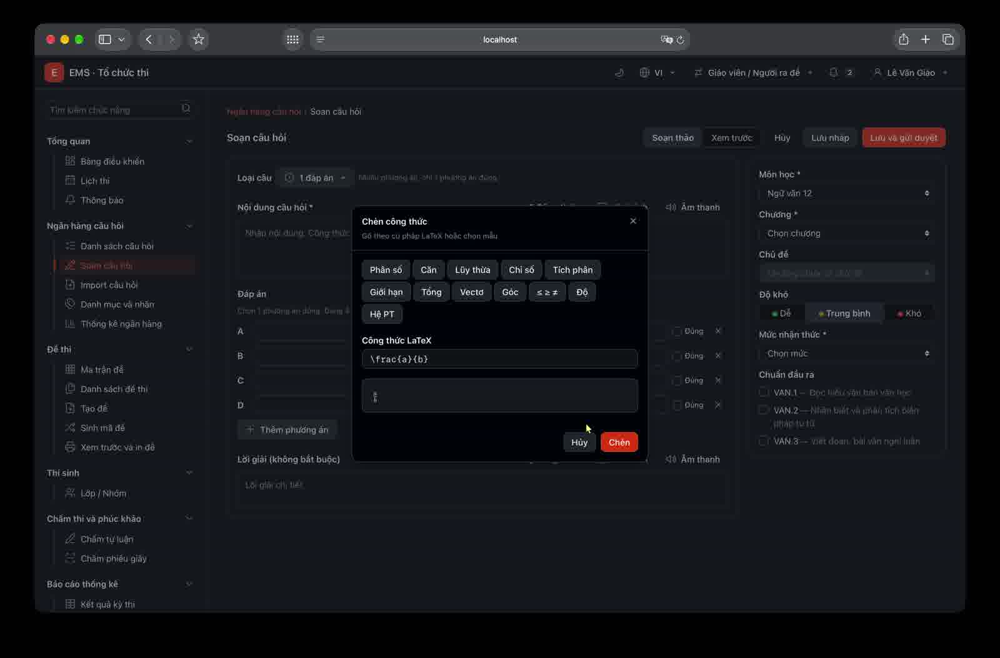

- Phụ đề "Gõ theo cú pháp LaTeX hoặc chọn mẫu".
- **13 chip mẫu**: Phân số, Căn, Lũy thừa, Chỉ số, Tích phân, Giới hạn, Tổng, Vectơ, Góc, ≤ ≥ ≠, Độ, Hệ PT.
- Ô "Công thức LaTeX" dùng **font monospace**, placeholder ví dụ `\frac{1}{2}x^2 + \sqrt{x}`.
- Ô **xem trước trực tiếp** bên dưới.
- Nút "Chèn" bị **disabled khi chưa nhập gì**. Bấm "Chèn" sẽ chèn `$\frac{a}{b}$` vào vị trí con trỏ.

**Xem trước** — `img/15`

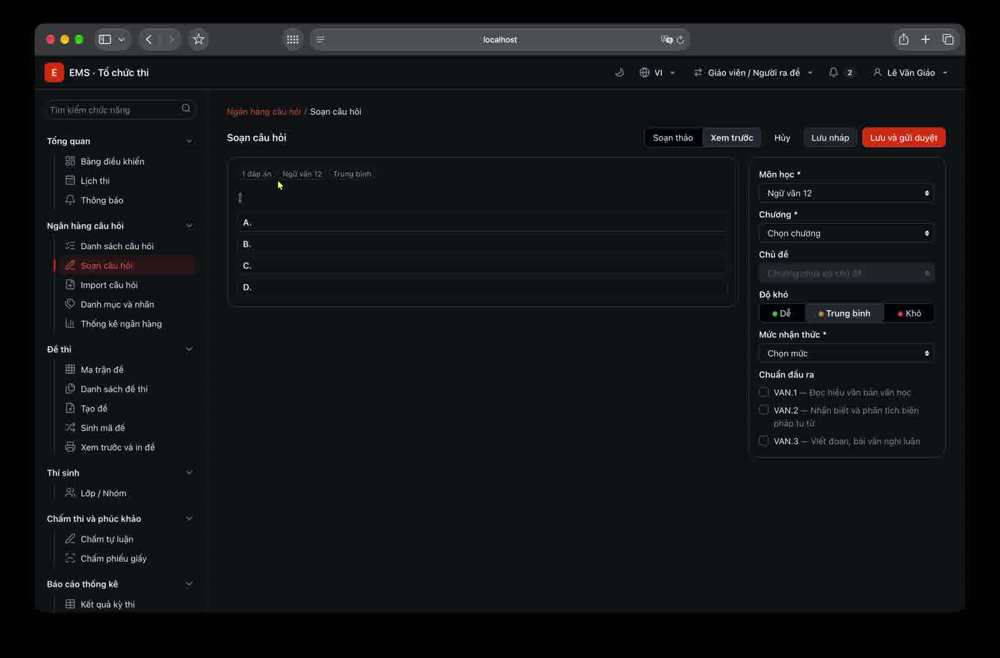

- Hiện chip (loại · môn · độ khó) + nội dung đã render + các phương án A–D, đúng như khi xem trong ngân hàng.

**Cần cải thiện (quan trọng):**
- **Soạn bằng textarea thô + cú pháp `$...$`**: giáo viên không rành LaTeX sẽ khó dùng. Nên làm **WYSIWYG** (TipTap/ProseMirror có node toán học, hoặc MathLive) để công thức hiển thị ngay trong lúc gõ.
- **Ô xem trước công thức quá nhỏ**: phân số render ở kích thước inline (~8px), gần như không đọc được (thấy rõ trong modal và chế độ Xem trước). Nên dùng **display mode** với cỡ lớn hơn.
- Nút "Công thức" vẫn hiện cho **Ngữ văn**: không sai, nhưng thanh công cụ có thể thích ứng theo môn.
- **Lẫn select gốc của trình duyệt** (Môn học, Chương, Mức nhận thức) với dropdown tự dựng (Loại câu). Giao diện không đồng nhất, và select gốc trông khác nhau trên Windows/macOS.
- Bấm "Hình ảnh" mở **thẳng file picker của hệ điều hành** (tiếng Anh "Choose Files to Upload"). Nên có vùng kéo-thả, dán ảnh từ clipboard, xem trước, crop và nhập alt text.
- Khi chuyển sang "Xem trước", panel metadata bên phải vẫn sửa được, dễ gây hiểu nhầm.
- Không thấy **tự động lưu nháp** hay cảnh báo "Bạn có thay đổi chưa lưu" khi bấm Hủy hoặc chuyển trang.
- Lỗi xác thực (validation) chưa được thể hiện trong video.

### 4.12 Trạng thái rỗng — `img/16`

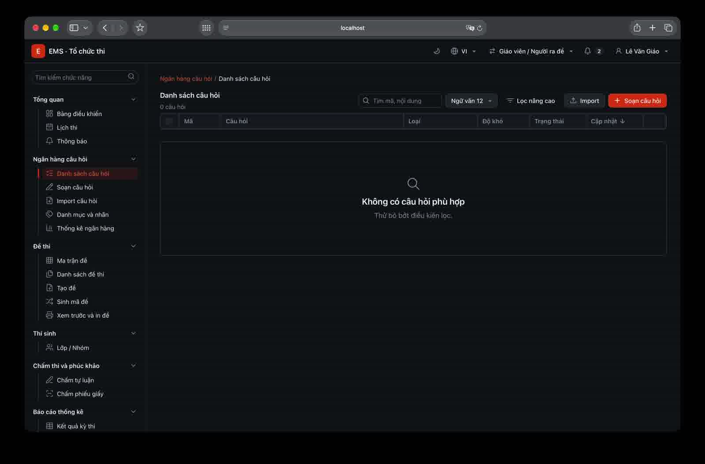

- Icon kính lúp, "Không có câu hỏi phù hợp", gợi ý "Thử bỏ bớt điều kiện lọc."
- **Cần cải thiện:** bộ lọc đang áp dụng chỉ là "Ngữ văn 12" (giáo viên Tổ Toán không có câu Văn). Nên có nút **"Xóa lọc"** ngay trong empty state, và CTA "Soạn câu hỏi đầu tiên" khi ngân hàng thực sự trống. Header bảng vẫn hiện checkbox (đã disabled) trên một bảng rỗng.

---

## 5. Các pattern UX đáng học (và áp dụng lại)

1. **Thiết kế theo vai trò (role-aware UI)**: cùng một màn hình, nhưng cột, nút và menu thay đổi theo quyền. Người dùng không thấy chức năng mình không được dùng.
2. **Quy trình duyệt minh bạch**: trạng thái rõ (Nháp → Chờ duyệt → Đã duyệt / Trả lại), góp ý bắt buộc khi trả lại, góp ý hiển thị nổi bật cho người soạn, lịch sử phiên bản dạng timeline.
3. **Giải thích trước, chặn sau**: nút xóa bị khóa kèm lý do ("15 câu hỏi đang gắn"), bộ lọc phụ thuộc ghi "(chọn môn trước)", ô Chủ đề ghi "Chương chưa có chủ đề", placeholder góp ý ghi quy tắc bắt buộc.
4. **Nội dung chuyên môn render đúng ở mọi nơi**: KaTeX trong bảng, modal, khung duyệt, xem trước.
5. **Đếm số ở mọi nơi**: "29 câu hỏi", tab "Chờ duyệt 6", "Độ khó 2", "Lọc nâng cao 2", cây "Toán 12 · 15". Người dùng luôn biết quy mô dữ liệu.
6. **Master–detail cho công việc xử lý hàng loạt** (duyệt), **modal cho tra cứu nhanh** (xem chi tiết), **trang riêng cho tạo mới** (soạn câu).
7. **Ngôn ngữ hình ảnh nhất quán**: icon loại câu, chấm màu độ khó, chip trạng thái được dùng lại ở bảng, bộ lọc, thống kê và form.
8. **Chỉ số chất lượng chuyên môn** ("Độ khó thực tế so với nhãn", "Đã dùng trong N đề thi"): dữ liệu phục vụ ra quyết định, không chỉ để đếm.

---

## 6. Danh sách vấn đề cần sửa (ưu tiên)

| # | Mức | Vấn đề | Đề xuất |
| --- | --- | --- | --- |
| 1 | Cao | Khối tài khoản demo, công tắc vai trò, chip "Mã 1.1 · Đợt 1" hiển thị trên UI | Ẩn bằng biến môi trường / feature flag trước production |
| 2 | Cao | Bảng tràn ngang, cột "Cập nhật" bị cắt khi có thêm cột | Cho chọn cột hiển thị, cố định cột ⋯, giới hạn độ rộng cột nội dung |
| 3 | Cao | Soạn công thức bằng textarea + `$...$` | Trình soạn WYSIWYG có node công thức; giữ LaTeX cho người dùng nâng cao |
| 4 | Cao | Xem trước công thức quá nhỏ | Render display mode, cỡ ≥ 18px trong ô preview |
| 5 | Trung bình | Phân trang và file picker còn tiếng Anh | Việt hóa toàn bộ, đưa chuỗi vào file i18n |
| 6 | Trung bình | Lẫn select gốc và dropdown tự dựng | Dùng một component Select/Combobox duy nhất |
| 7 | Trung bình | Modal chi tiết chỉ có nút "Xóa" | Thêm Sửa / Nhân bản / Duyệt theo quyền, đưa Xóa vào menu phụ |
| 8 | Trung bình | Có checkbox nhưng không có hành động hàng loạt | Thanh hành động nổi khi chọn ≥ 1 dòng |
| 9 | Trung bình | Thẻ KPI không bấm được | Bấm KPI → mở danh sách đã lọc tương ứng |
| 10 | Trung bình | Đỏ vừa là màu thương hiệu vừa là màu nguy hiểm | Tách token `brand` và `danger` |
| 11 | Thấp | Ngày dạng `8/10/26` | `08/10/2026` hoặc thời gian tương đối + tooltip |
| 12 | Thấp | Tương phản chữ meta ở dark mode thấp | Tăng sáng `text-muted` để đạt WCAG AA (≥ 4.5:1) |
| 13 | Thấp | Nút giao diện chỉ có icon, thiếu nhãn | Thêm `aria-label` + tooltip |
| 14 | Thấp | Biểu đồ toàn màu xám | Tô theo màu ngữ nghĩa, thêm % |
| 15 | Thấp | Empty state không có hành động | Thêm "Xóa lọc" / "Soạn câu hỏi" |
| 16 | Thấp | Chưa có phím tắt cho người duyệt | J/K chuyển câu, A duyệt, R trả lại |

---

## 7. Gợi ý áp dụng cho English Center Management System

Phong cách của EMS phù hợp làm **tham chiếu thiết kế** cho hệ thống quản lý 4 trung tâm tiếng Anh, vì cùng là phần mềm nghiệp vụ, nhiều vai trò, nhiều bảng dữ liệu và có quy trình duyệt.

| Pattern trong EMS | Áp dụng cho trung tâm tiếng Anh |
| --- | --- |
| Top bar có chuyển vai trò | Chuyển **trung tâm** đang làm việc (Trung tâm 1–4 / Tất cả) + chuyển vai trò cho người giữ nhiều vai trò |
| Sidebar nhóm theo module, thay đổi theo vai trò | Nhóm: Tổng quan · Học viên & PH · Lớp & lịch · Điểm danh · Học phí · Tuyển sinh · Báo cáo · Cấu hình |
| Chip trạng thái màu ngữ nghĩa | Trạng thái ghi danh: Chờ xếp lớp · Đang học · Bảo lưu · Hoàn thành · Ngừng học; công nợ: Đã đóng · Còn nợ · Quá hạn |
| Duyệt master–detail + góp ý bắt buộc khi trả lại | Duyệt **hoàn phí**, **ưu đãi vượt mức**, **mở khóa điểm danh**, **điều chỉnh buổi** |
| Lịch sử phiên bản dạng timeline | **Sổ phát sinh buổi học** và **lịch sử thanh toán** của từng ghi danh |
| Nút xóa bị khóa kèm lý do | "Không thể xóa lớp: còn 12 học viên đang học — chuyển học viên trước" |
| KPI card có ngữ cảnh | Học viên đang học · Doanh thu tháng · Công nợ quá hạn · Học viên sắp hết buổi · Lớp thiếu sĩ số |
| Bộ lọc phụ thuộc + đếm + Xóa lọc | Lọc học viên theo Trung tâm → Khóa → Lớp, trạng thái, số buổi còn lại |
| Dark mode + Theo hệ thống | Giữ nguyên |

**Không nên sao chép:** select gốc lẫn dropdown tự dựng, phân trang tiếng Anh, footer modal chỉ có nút Xóa, KPI không bấm được.

---

*Ghi chú: màu sắc và kích thước là ước lượng từ video đã nén. Cần mã nguồn hoặc file thiết kế gốc để có giá trị token chính xác.*
